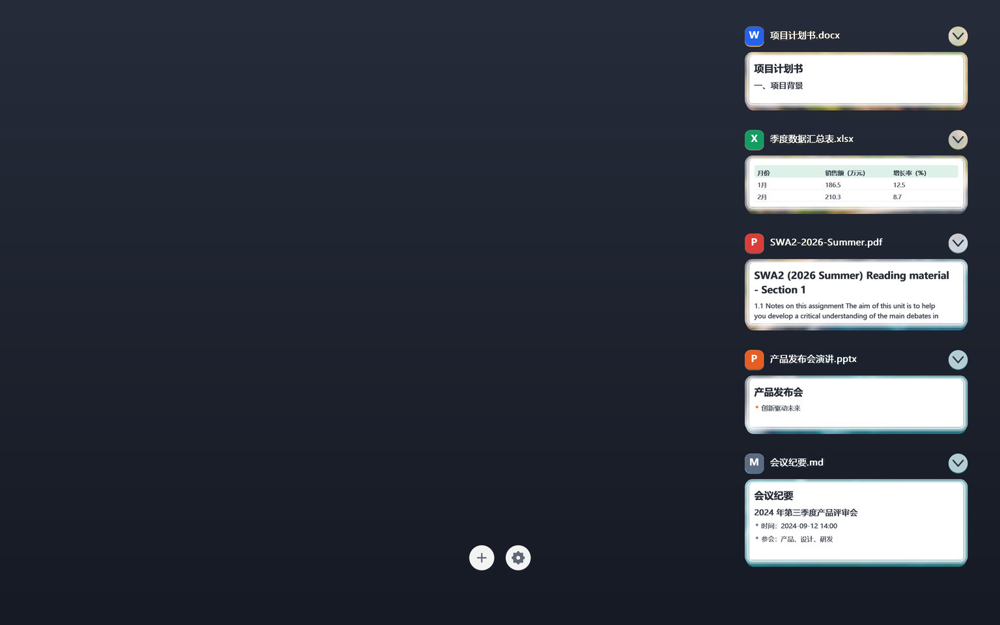

# better desktop


> Windows desktop cards: pin files to the wallpaper as readable paper sheets — drag, resize, fold, and tidy them into a right-hand rail.
>
> Windows 桌面卡片：把文件变成壁纸上的纸面卡片，真实文档预览，可拖动、缩放、折叠，一键整理成右侧列表，点一下打开。



覆盖层是一个**逐像素 alpha 的分层窗口**（`WS_EX_LAYERED | WS_EX_NOACTIVATE | WS_EX_TOOLWINDOW`）：
透明处完全穿透，只有卡片和按钮能点。渲染是纯软件光栅（SDF 抗锯齿 + 每卡缓存位图），不依赖 GPU。

## 运行

```sh
cargo run                 # 调试构建（opt-level=2，够快）
cargo build --release     # 精简发布版：LTO + strip + panic=abort，约 0.95 MB
```

单实例：同名互斥体 `BetterDesktop.SingleInstance.v1`，重复启动会直接退出。

## 操作

| 操作 | 效果 |
|---|---|
| 单击纸面 | 打开文件 |
| 拖动卡片 / 页眉 | 移动（贴边、贴其他卡片会吸附并显示引导线；按住 Alt 关掉吸附） |
| 拖四边 / 四角 | 独立调宽高，预览自动重排 |
| 滚轮 | 等比缩放；在右侧滑动槽内滚轮 = 滚动整列 |
| 双击页眉 / 右上箭头 | 折叠成标题胶囊 ↔ 展开 |
| 右键卡片 | 打开 / 折叠 / 刷新缩略图 / 移除 |
| 拖文件到卡片或 `+` 上 | 生成卡片（文件夹会展开前 8 个文件） |
| `Ctrl+Alt+D` | 剪贴板或资源管理器选中的文件 → 卡片（重复文件自动去重） |
| `Ctrl+Alt+H` | 全部折叠 ↔ 全部展开 |
| `Ctrl+Alt+T` | 整理成右侧一列（放不下时自动变成可滚动列） |
| 齿轮菜单 | 刷新缩略图 / 重采样壁纸 / 置顶显示 / 全部折叠·展开 / 整理成列 / 配置目录 / 退出 |

## 图标

exe 内嵌了 `icon.ico`（`app.rc` + `build.rs`，windres 编译），托盘图标也用它；同时写入版本信息（FileVersion / ProductName / MIT）。
重新生成图标：`python tools/make-icon.py`（需要 Pillow），会同时输出 `icon.ico` 与 `docs/icon.png`。

## 命令行

```sh
better-desktop --version   # 版本号 + 仓库地址（弹窗，GUI 程序无控制台）
better-desktop --help      # 快捷键速查
```

托盘图标右键还有「关于 Better Desktop」。发布版是 GUI 子系统程序，双击不会弹出黑色控制台窗口。

## 预览是怎么来的

| 类型 | 预览 |
|---|---|
| 图片 | 直接用原图，卡片自动按图片比例变横/竖 |
| PDF | 有文字层时按正文排版渲染；没有文字层时用 `Windows.Data.Pdf` 栅格化首页 |
| DOCX / XLSX / MD / TXT | 解析 OOXML / 文本，按标题、正文、表格排版成可读的纸张 |
| PPTX | 优先用第一页里最大的那张图（设计稿式的幻灯片最接近真实观感）；没有图则退回前 3 页的文字 |
| 其他 | 系统缩略图（`IShellItemImageFactory`），空白缩略图会被丢弃 |

## 多显示器

- 工作区、边距、卡片尺寸都按**各自显示器**的 DPI 计算（`GetDpiForMonitor`），150% 与 100% 并排时观感一致
- 卡片拖到另一块屏时按比例重排（例如 175% → 125% 会把卡片缩到 0.714×），视觉大小保持不变
- 新卡片按落点所在屏的缩放创建；两个操作按钮固定在**主屏**底部，不会落在两块屏的接缝上
- 卡片坐标与工作区统一使用「虚拟桌面左上角为原点」的坐标系，副屏在主屏上方/左侧也不会错位
- 排查工具：`BD_DPI=1` 打印每块屏的工作区与 DPI

## 配置

`%APPDATA%\BetterDesktop\config.json`（旧版放在 exe 旁边的 `.better-desktop\` 会自动迁移）。

```jsonc
{
  "cards": [
    { "x": 2259, "y": 70, "width": 743, "height": 300,
      "path": "D:\\...\\report.pdf", "color": [120,120,120],
      "auto_fit": false, "collapsed": false }
  ],
  "topmost": true,   // 压在普通窗口之上
  "rail": false      // 当前是否为「整理成列」状态
}
```

## 结构

单文件 `src/main.rs`（约 3.7k 行），按段落分块：

| 段落 | 内容 |
|---|---|
| `Card` / `AppConfig` | 数据模型、几何（`box_w`/`box_h`/`visual_x`）、JSON 读写 |
| `Framebuffer` | 光栅：`round_rect`、`glass_paper`（纸面 + 玻璃边）、`span_opaque` |
| 文本 | `render_text_to_bitmap`（GDI + alpha 位图缓存）、`measure_text`、`wrap_lines` |
| 内容提取 | docx/pptx/xlsx（zip + XML）、pdf（inflate 文字层 / WinRT 页面栅格）、md/txt/csv |
| `paint_card` / `draw_card` | 卡片绘制与每卡缓存、`blit_card` 合成 |
| 桌面 | `work_areas`、`snap_position`、`place_free`、`clamp_card`、`tidy_column`、`pack_column` |
| 窗口 | `install_layered_style`、`apply_zorder`、`Presenter::present`（`UpdateLayeredWindow`） |
| 交互 | 事件循环：拖动、四边缩放、折叠、右键菜单、热键、托盘 |

## 开发脚本

- `tools/make-preview-config.py` 生成用于截图的临时卡片布局（会先备份现有配置）
- `tools/compose-preview.py` 把 `frame.bmp` 合成到中性渐变背景上，输出 `docs/preview.png`

截图刻意用纯色渐变而非真实壁纸：避免把第三方壁纸一起放进仓库。

## 开发探针

环境变量开关，仅用于调试，正常使用不用管：

- `BD_DUMP=1` 把合成结果写成 `<配置目录>\frame.bmp`
- `BD_SNAP="x,y,w,h"` 打印吸附结果后退出
- `BD_BACKDROP=1` 报告壁纸采样来源
- `BD_BENCH=<n>` headless 连续渲染 n 帧并打印耗时
- `BD_PROBE=<paths|dir>` 只加载指定文件
- `BD_SCROLL=<px>` 让右侧列滚动指定像素后再 dump
