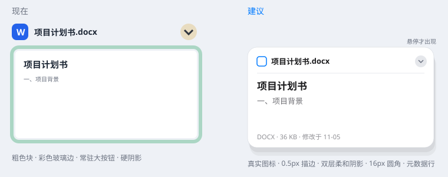

# Better Desktop：Apple 风格视觉改进建议

参考对象：macOS Sonoma 桌面小组件、Finder / Quick Look。代码位置基于当前 `src/main.rs`。



按效果从大到小排序；前 4 条最明显。

## 1. 纸面边缘：去掉彩色玻璃边，改用细白线 + 柔和阴影

**现状**
- `glass_paper` 沿纸面画了 6px 半透明白边（`paint_card` 中 `band = 6.0 * s`）；`blit_card` 把这圈边合成在饱和过的模糊壁纸上。纸面底边因此出现黄 / 绿 / 青色污痕，是整体显脏的主因。
- 阴影只是一块偏移 (2,3)、alpha 26 的硬边矩形（`paint_card` 约 2167 行）。

**建议**
- 把 `band` 缩到 1px 描边（白色，alpha 约 0.5）；或在 backdrop 里先去饱和，再混入约 70% 白色。
- 硬阴影换成两层带模糊的 SDF 阴影：

```rust
fn soft_rect(&mut self, x: f32, y: f32, w: f32, h: f32, rad: f32, blur: f32, c: (u8,u8,u8), a: u8) {
    // 沿用 round_rect 的距离场循环，范围外扩 blur 像素
    // let t = ((d + blur) / (2.0 * blur)).clamp(0.0, 1.0);
    // let cov = 1.0 - t * t * (3.0 - 2.0 * t);   // smoothstep 衰减
}
// 漫射阴影：blur = 24*s，向下偏移 8*s，黑色，alpha ≈ 40
// 接触阴影：blur =  2*s，向下偏移 1*s，黑色，alpha ≈ 30
```

- 阴影变大后，`draw_card` 的缓存外边距 `pad = 16*s` 要加到约 `32*s`，否则阴影被裁掉。卡片位图有缓存，只多一次绘制，平时每帧不会变慢。
- **圆角**：现有内外圆角已经同心（`irad = rad - band`），但整体偏小。外层 `12.0 * s` 提到 14–16。可以考虑换成超椭圆（squircle，`|x|^n + |y|^n`，n≈5）。
- **毛玻璃**：窗口是 `WS_EX_LAYERED` + `UpdateLayeredWindow`，Mica / Acrylic 对它不生效，材质效果继续沿用现有的壁纸采样 + `box_blur` 自绘。

## 2. 标题栏：去掉字母色块和"假描边"

**现状**
- 标题左边是 30px、高饱和的 `W/X/P/M` 方块。
- 白色文件名下面叠了三遍偏移的深色文字（约 2126 行），看起来像描边字。

**建议**
- 类型标识改用系统真实文件图标（`SHGetFileInfo` / `IShellItemImageFactory`，32px）。这也和 `vibe_images/` 设计稿一致。
- 文件名下的多层偏移叠字，换成一层模糊阴影（模糊 2–3px，alpha 0.35）。
- 不要恢复整块玻璃卡身（第 2100 行注释写明是有意去掉的）。标题可以保留在纸外面；或者作为白纸内部第一行，用 0.5px 细线和正文隔开。
- 纸面底部加一行元数据："DOCX · 36 KB · 修改于 …"，11px，次要文字色。
- 强调色改用 Apple 系统色：

| 类型 | 现在 | Apple 系统色 |
|---|---|---|
| DOCX | (36,98,234) | systemBlue (0,122,255) |
| XLSX | (21,156,98) | systemGreen (52,199,89) |
| PDF | (216,63,58) | systemRed (255,59,48) |
| PPTX | (230,94,35) | systemOrange (255,149,0) |
| 图片 | (110,95,222) | systemIndigo (88,86,214) |
| 其他 | (148,160,176) | systemGray (142,142,147) |

## 3. 操作按钮：平时隐藏，悬停才出现

**现状**：每张卡都常驻一个 30px 的米色圆形折叠按钮，粗箭头是全图最显眼的元素。`paint_card` 的 `_hovered` 参数接收了但没有使用。

**建议**
- 折叠按钮缩到 20–22px，箭头线宽 1.5px，只在悬停时用约 150ms 淡入（参考 macOS 小组件右上角的"−"按钮）。
- 底部 `+` 和齿轮两个圆钮合并成一个毛玻璃胶囊工具栏（`+` 和 `⋯`）。现在用 8 个方块拼出的齿轮换掉。
- 悬停：阴影略加深，整体放大 1.01 倍。拖起：放大 1.03 倍并换更深的阴影，替代单纯上移 8px。

## 4. 字体渲染与层级

- 第 1849 行 `CreateFontW` 的 quality 参数从 `5`（CLEARTYPE_QUALITY）改为 `4`（ANTIALIASED_QUALITY）。第 1867 行把 RGB 压成 `max(r,g,b)` 当 alpha，ClearType 的子像素结果会让笔画偏粗、深浅不均。长期可以换 DirectWrite。
- 字体保留 `Microsoft YaHei UI`：它的英文字形源自 Segoe UI；`Segoe UI Variable` 只在 Win11 上有，`UI_FONT` 也没有回退链。
- YaHei UI 只有 Light / Regular / Bold。代码里的 600 会落到 Bold 或合成加粗，层级只用 400 和 700 两档，再用颜色透明度拉开差别。
- `draw_doc_page` 现在有四档字号（15.5 / 12.5 / 10.5 / 9.5），建议减为：标题 17 Bold、正文 13 Regular、次要文字 11。
- 墨色改为中性黑加透明度：主文字 `rgba(0,0,0,0.85)`，次要 `0.5`，三级 `0.25`。现在的 (62,68,80) 偏蓝灰。
- 表格：表头去掉强调色底色，只用加粗 + 次要色；分隔线 0.5px，`rgba(60,60,67,0.29)`。

## 5. 间距统一到 8pt 网格

现有间距 6 / 10 / 15 / 16 / 30 / 46 混用，统一为 4 / 8 / 12 / 16 / 20 / 24：
- `CARD_PAD`：15 → 16
- 标题区高度：46 → 44 或 48
- 纸内边距：15 → 16

## 6. 动效

- 入场：现在是 0.35s 三次缓出 + 上滑 18px。改成弹簧曲线（response ≈ 0.4s，damping ≈ 0.82），配合 opacity 0→1 和 scale 0.96→1，位移不超过 8px。
- 折叠 / 展开：高度和纸面透明度一起用弹簧过渡。
- 整理成列：各卡片依次错开 20–30ms 移动到位（参考 Stage Manager）。

## 7. 可选

- **深色模式**：读注册表 `AppsUseLightTheme`，深色时纸面用 #1C1C1E，文字用白色加透明度。
- **Sonoma 的"桌面小组件褪色"**：有普通窗口挡在前面时，卡片去饱和并降低透明度；露出桌面时恢复全彩。可以和 `topmost` 设置配合。
- **图标**：去掉外圈浅蓝描边；顶部蓝条距卡片边缘只有 3%（`tools/make-icon.py` 第 42–43 行），几乎压在白色内描边上，内缩加到约 6%，改成单一实体（白纸 + 一条细的强调色 + 超椭圆轮廓）。
